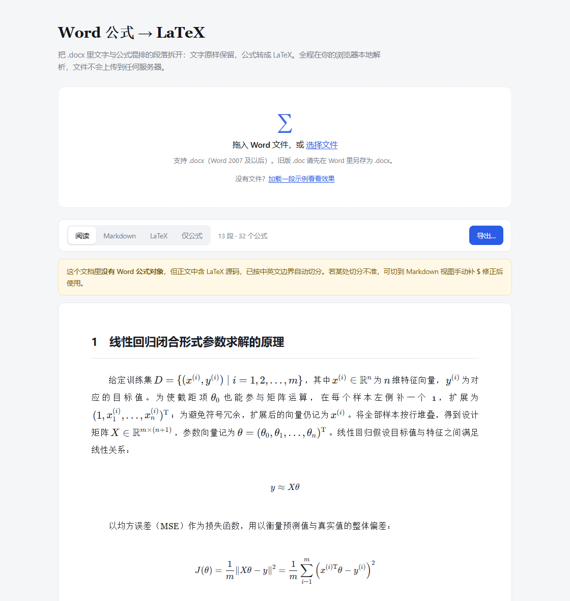
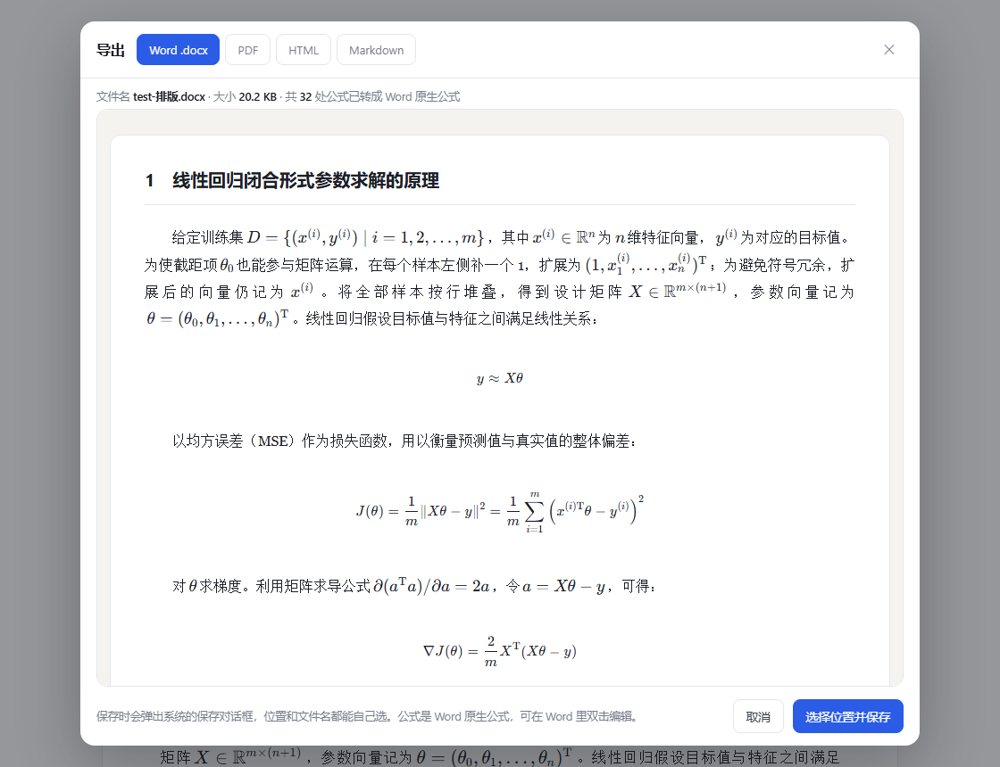

# Word 公式 → LaTeX

把 `.docx` 里文字与公式混排的段落拆开：**文字原样保留，公式转成 LaTeX**；如果文档里的公式本来就是裸 LaTeX 源码，就把它们**渲染成正常排版的公式**，并导出一份能直接交出去的文档。

单文件、零安装、**完全离线**——不装 Python，不装 pandoc，文件不上传。双击 HTML 就能用。



## 为什么需要它

Word 里的公式**不是文字**，是一套叫 OMML 的 XML，藏在 docx 那个压缩包里。所以普通"读取文本"的工具（包括 `python-docx`）读出来，公式会整个消失——你只会看到一段缺了东西的句子。

实际操作中会遇到的其实是三种情况，处理方式完全不同：

| 公式的存法 | 长什么样 | 能否处理 |
|---|---|---|
| **OMML**（Word 2007+ 自带公式） | 双击能进公式编辑器 | ✅ 转成 LaTeX 代码 |
| **裸 LaTeX 源码** | 正文里直接写着 `\frac{1}{m}\lVert X\theta - y\rVert^2` | ✅ 渲染成排好版的公式 |
| MathType / Equation 3.0 / 公式截图 | 是 OLE 对象或图片，不是文本 | ❌ 只能 OCR 或手工重打 |

工具会自动判断属于哪一种，并在界面上说明，不会静默漏掉。

## 快速开始

**方式一（推荐）**：下载 `word-math-to-latex.html`，双击用 Chrome / Edge 打开。没装过任何环境也能跑。

**方式二**：如果开启 GitHub Pages，则是 `index.html`，直接在线用。

打开后把 `.docx` 拖进去，或者点「加载一段示例看看效果」。

## 界面

四个视图切换：

- **阅读** —— 整篇按文档排版渲染，公式是真正的数学符号
- **Markdown** —— 带 `$...$` 的源码，可直接贴进 Typora / Obsidian
- **LaTeX** —— 纯 LaTeX 源码，中文会转义成 `\%` `\_` 这类
- **仅公式** —— 只列出含公式的段落，方便核对

## 导出

点「导出…」打开对话框，**先预览再保存**，保存位置由你选（走系统保存对话框）。



| 格式 | 说明 |
|---|---|
| **Word `.docx`** | 公式写成 **Word 原生公式对象（OMML）**，在 Word 里双击可编辑，能被公式工具识别。不是图片 |
| **PDF** | A4，走浏览器打印。位置和文件名在打印对话框里选 |
| **HTML** | 自包含单文件，公式/样式/字体全部内联，`grep http` 为 0，发给别人也能正常看 |
| **Markdown** | 带 `$...$` 的纯文本 |

> PDF 那一栏无法用系统保存对话框——浏览器的 PDF 由打印引擎生成，不能写入指定文件句柄。所以按钮是「打印 / 另存为 PDF」，在打印对话框里把目标选成「另存为 PDF」即可。

## 转换覆盖范围

OMML → LaTeX 是自己写的转换器，覆盖这些结构：

分式 · 上下标（含前后置 `sPre`）· 根式 · 求和/积分/连乘（含 `\limits` 上下限位置）· 括号定界 `\left...\right` · 函数 `\sin` `\lim` · 重音 `\hat` `\vec` · 上划线 `\overline` · 矩阵 · 方程组 · `\boxed` · 重音/框线（`groupChr`）· 希腊字母与集合/箭头等 Unicode 符号

细节处理：

- 公式内部的中文包成 `\text{当}`，不会散架
- 反斜杠转成 `\backslash`，不会被 LaTeX 当成换行
- 双线体/花体/哥特体分别映射 `\mathbb` `\mathcal` `\mathfrak`
- 输出依赖 `amsmath`（矩阵、`\text{}`、`\boxed{}`），XeLaTeX 可直接编译

## 技术实现

难点在于「零依赖」和「公式可编辑」这两个约束同时成立：

```
.docx ─┬─ DecompressionStream ──▶ document.xml ──▶ OMML ──▶ LaTeX
       │                              （自研 ZIP 解析 + 自研 OMML 转换器）
       └─ 裸 LaTeX 源码 ──▶ 中英边界切分 ──▶ KaTeX ──▶ 渲染
                                          │
                    TeX ──KaTeX──▶ MathML ──MML2OMML.XSL──▶ OMML ──手写 ZIP──▶ .docx
```

几个关键选择：

- **自己解 ZIP**：浏览器自带 `DecompressionStream('deflate-raw')`，读 EOCD → 中央目录 → 本地头就能拿到 `word/document.xml`，不需要 JSZip。
- **`MML2OMML.XSL` 内嵌**：这是微软随 Office 分发的官方样式表，把 MathML 转 OMML。确认过是纯 XSLT 1.0、不含 `msxsl` 扩展函数，所以**浏览器可以直接跑**——不需要 pandoc，也不需要在目标机器上装 Office。
- **自己打 ZIP**：docx 就是个 zip，用 store（不压缩）+ CRC32 表拼 8 个部件即可，比引库更可控。
- **KaTeX 全内嵌**：JS + CSS + 20 个 woff2 字体全部 base64 进 HTML。这是"彻底断网"的硬前提，否则断网时公式会变成方框套代码。

代价是主文件有 892KB。本地打开无感，换来的是零网络请求。

## 项目结构

```
word-math-to-latex.html   主产物：单文件工具（含界面 + 转换核心 + 内嵌 KaTeX/XSL）
index.html                给 GitHub Pages 用的入口（跳转到上面的文件）
test-core.mjs             转换核心单测（node 直接跑，无需浏览器）
build-doc.mjs             命令行版：docx → 排版好的自包含 HTML
bundle-offline.mjs        把 KaTeX 重新内嵌进 HTML（升级 KaTeX 版本时用）
docs/                     README 截图
```

## 开发

```bash
npm install

# 跑单测：17 个 OMML 用例 + ZIP 解包链路
npm test

# 命令行批量生成：docx → 自包含 HTML（公式用 MathJax 预渲染成 SVG）
node build-doc.mjs 输入.docx 输出.html
```

`test-core.mjs` 的做法值得一提：转换核心放在 HTML 的 `<script id="core">` 块里并挂到 `window.MathCore`，测试时用一个 60 行的迷你 DOM（`MiniNode` / `MiniDoc` + 正则 XML 解析）在 node 里加载那段代码。**不用装 jsdom、不用开浏览器**，改完核心直接 `node test-core.mjs`，失败用例会打印出实际的 LaTeX，对着改就行。

## 已知限制

- **MathType / Equation 3.0 / 公式截图** 无法转换，界面会明确提示属于哪一种
- 复杂公式偶尔有偏差，建议转换后抽查几个关键的
- 裸 LaTeX 的自动切分靠中英边界，像「补一个 1」这种孤立数字不会渲染（否则正文会碎掉）；切分不准时可切到 Markdown 视图手动补 `$`
- docx 导出用的字体是宋体 / 黑体 / Cambria Math，目标机器没有这些字体时 Word 会替换，版式可能略微位移

## License

MIT
